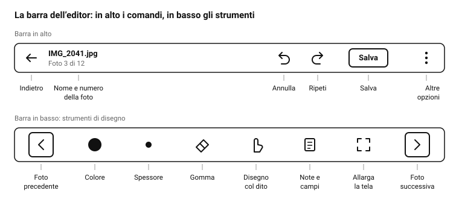

# Pastashoot — Guida rapida

Pastashoot raccoglie le foto di un sopralluogo, le annota con pennino, dita e note di testo, e alla fine consegna una cartella ordinata con ZIP e report PDF. Funziona su telefoni e tablet Android 10 o successivi.

## Installazione e primo avvio

1. Scarica `pastashoot.apk` dalla pagina [Releases › latest](https://github.com/sambusek/foto-note/releases/tag/latest) e aprilo. La prima volta Android chiede di consentire l'installazione da Chrome o da Archivio.
2. Scrivi il tuo nome: comparirà nel saluto e potrà finire nei campi delle note e nei nomi dei file.
3. Concedi l'accesso alle foto e alla posizione GPS delle foto, poi le notifiche.
4. Per accorgersi subito dei nuovi scatti, lascia l'app libera di lavorare in background: Impostazioni del telefono › App › Pastashoot › Batteria › «Senza restrizioni».

Gli aggiornamenti si installano sopra la versione precedente, senza perdere nulla. Non disinstallare mai l'app: è l'unico modo per perdere sopralluoghi e annotazioni.

## Cantieri e planimetrie

Il **cantiere** raccoglie nel tempo i sopralluoghi dello stesso luogo, con le sue **planimetrie** e lo schema dei campi da cui partono i nuovi sopralluoghi. Dalla Home: **Cantieri e planimetrie**.

- **Nuovo cantiere…**: nome ed eventuale template da cui prendere i campi.
- **Carica planimetrie (PDF)…**: ogni pagina del PDF diventa una tavola, che puoi rinominare (es. «Piano 3»).
- **Nuova revisione…** (toccando una tavola): carichi la versione aggiornata. Vale per i prossimi sopralluoghi; quelli chiusi restano sulla revisione che usavano. Un sopralluogo ancora aperto ti propone di passare alla nuova, con i pin nello stesso punto della pagina.
- I sopralluoghi creati prima dei cantieri, e quelli veloci, stanno nel cantiere **Generico**.

**Pin delle foto.** Nel sopralluogo apri ⋮ › **Planimetrie…**: scegli una foto nella striscia in basso e tocca la pianta nel punto in cui l'hai scattata; si passa da soli alla foto successiva senza pin. Con due dita ingrandisci e sposti la pianta. Toccando un pin scegli la sua foto, per spostarla, toglierla o aprirla. Dall'editor di una foto c'è anche ⋮ › **Posiziona sulla pianta…**.

## Fare un sopralluogo

Un sopralluogo raccoglie da solo tutte le foto scattate con la fotocamera del telefono dal momento in cui lo inizi. Non serve scattare dall'app.

1. Nella Home tocca **Inizia sopralluogo…**, scegli il cantiere (viene proposto l'ultimo usato) e scrivi il nome, che diventerà anche il nome della cartella. I campi arrivano dal cantiere.
2. Scatta con la fotocamera di sempre, o dal pulsante **Fotocamera** nella schermata del sopralluogo. Le foto compaiono nella griglia.
3. Se ti servono foto fatte prima, usa ⋮ › **Aggiungi foto già scattate…**.
4. Tieni premuta una foto per due scelte: **Escludi dalle versioni** la lascia nel sopralluogo ma fuori da versioni e consolidamento; **Togli dal sopralluogo** la fa sparire dalla griglia, ma resta nella Galleria del telefono. Per riaverla usa **Aggiungi foto già scattate…**.
5. Per una pausa (pranzo, foto personali) tocca **Metti in pausa**: gli scatti fatti in pausa restano fuori. Riprendi quando torni in cantiere.

### Precompilare i campi mentre scatti

Se scatti molte foto nello stesso punto, puoi far compilare da soli i campi dei prossimi scatti. Esempio: al terzo piano lato via Gonzaga.

1. Nel sopralluogo apri ⋮ › **Precompila i campi…**, accendi «Piano» e scegli 3, accendi «Affaccio» e scrivi Gonzaga, poi **Applica**.
2. Scatta: ogni nuova foto ha già Piano 3 e Affaccio Gonzaga. Una fascia in alto ricorda cosa è attivo.
3. Passi al lato via Mazzini: tocca **Modifica** sulla fascia e cambia solo l'affaccio. Le foto già scattate restano con Gonzaga.
4. Per smettere, spegni i singoli campi o tocca **Spegni tutto**.

Sulla singola foto puoi sempre correggere o svuotare un valore precompilato.

Per cambiare nome a un sopralluogo, anche in corso, usa ⋮ › **Rinomina…**: le prossime versioni e il consolidamento useranno la cartella con il nuovo nome, mentre le versioni già emesse restano nelle loro cartelle.

### Più cantieri nella stessa giornata

Puoi tenere aperti più sopralluoghi, ma uno solo alla volta raccoglie le foto. Esempio: inizi nel cantiere A, poi vai nel cantiere B.

1. Dalla Home tocca **Inizia sopralluogo…** per il cantiere B: il sopralluogo A va in pausa da solo e compare sotto «In pausa».
2. Quando torni al cantiere A, aprilo e tocca **Riprendi**: ora è B ad andare in pausa.

Le foto scattate mentre un sopralluogo è in pausa non entrano in quel sopralluogo.

## Annotare le foto

Tocca una foto della griglia per aprirla nell'editor. Le modifiche si salvano quando passi a un'altra foto o chiudi, e restano modificabili finché il sopralluogo non è consolidato.

- **Disegno**: si disegna con la S Pen, il tratto segue la pressione. Con le dita sposti e ingrandisci la foto. Tenendo premuto il tasto della S Pen cancelli al volo.
- **Strumenti** (barra in basso): colore, spessore e gomma. Annulla, ripeti e Salva sono nella barra in alto. Il pulsante con la mano permette di disegnare anche con il dito.
- **Note e campi**: il pulsante delle note apre il testo libero e i campi del layout (es. Piano, Locale). Su tablet in orizzontale il pannello sta di lato.
- **Foto dopo foto**: con le frecce colorate, o scorrendo, passi alla foto precedente o successiva senza tornare alla griglia.
- **Tela più grande**: ⋮ › **Allarga la tela** aggiunge spazio bianco intorno alla foto, per schizzi e quote. Trascina i bordi o le maniglie, poi torna al disegno.
- **Stessa nota su più foto**: nella griglia del sopralluogo usa il pulsante del testo, seleziona le foto e scrivi una volta sola.

Il testo e i campi finiscono in bianco su una fascia nera aggiunta sopra o sotto la foto: l'immagine originale non viene coperta né modificata.

## Campi, layout e template

Il layout decide quali campi si compilano e dove si stampano sulle foto. Lo imposti per ogni sopralluogo da ⋮ › **Campi e layout…**; un template lo prepara una volta per tutti i sopralluoghi simili. La schermata ha due pagine.

**Campi: cosa si compila.** Per ogni campo scegli tipo e nome, le voci se è un elenco, e se stampare l'etichetta prima del valore. Le frecce danno l'ordine nel pannello dell'editor.

| Tipo di campo | Cosa contiene | Esempio |
| --- | --- | --- |
| Testo | Scritto a mano foto per foto | Osservazione |
| Scelta | Solo una delle voci della lista, importabile da TXT o CSV | Piano: P3, P4 |
| Data, Ora | Riempiti da soli con il momento dello scatto | 17/11/2026 |
| Sopralluogo, Utente | Riempiti da soli con il nome del sopralluogo e il tuo | 261118 SAL |
| Fisso | Stesso testo su tutte le foto | Committente |

**Layout: dove si stampa.** I campi sono etichette nella **banda superiore** o in quella **inferiore**, aggiunte sopra e sotto la foto. In ogni banda si stampano in fila, separate da un punto; la nota della foto va a capo nella banda inferiore. Tocca un'etichetta per scegliere:

- in quale banda stamparla, oppure **Non stampare**: il campo si compila e vale per i nomi dello ZIP e per l'ordine delle foto, ma non va sulla foto (lo ritrovi nel vassoio «Non stampati»);
- **Prima** o **Dopo**, per l'ordine nella banda.

**Catene.** Con **Nuova catena…** unisci più campi in un valore unico, per esempio `3_Bagno_012`: tocca i campi nell'ordine in cui vanno uniti, sistemalo con le frecce, scegli separatore e banda e dai un nome alla catena (serve nei nomi dello ZIP). Nella banda la catena è un'etichetta sola: toccala per modificarla o scioglierla.

I template si gestiscono da Impostazioni › **Template di sopralluogo**. Si possono condividere e importare su un altro telefono; con **Copia i campi da…** riprendi i campi di un altro sopralluogo o template.

## Versioni, chiusura e consegna

Le foto annotate non vengono salvate una per una: escono tutte insieme quando emetti una versione o consolidi. Gli originali restano sempre intatti.

- **Emetti versione** salva le foto annotate in `Immagini › Pastashoot › AAMMGG_NOME_v01`, poi `_v02` e così via. Il sopralluogo resta aperto e modificabile. Le versioni emesse sono in ⋮ › **Versioni emesse**, dove puoi anche eliminarne una con il cestino: si cancellano le sue foto annotate, ma originali, disegni e note restano.
- **Consolida definitivo** salva la versione finale in `Immagini › Pastashoot › AAMMGG_NOME` e chiude il sopralluogo: da quel momento disegni e note non si modificano più. Nella Home compare con il lucchetto.
- **Nota generale** (⋮ › **Nota generale…**): un testo sull'intero sopralluogo, che va in testa al PDF e come file di testo nello ZIP.

Da un sopralluogo chiuso puoi creare e condividere:

- **ZIP** delle foto, con i nomi dei file costruiti come vuoi da numero, nome originale, sopralluogo, utente, data, ora e campi (es. `01_P3_Bagno.jpg`);
- **Report PDF** con le foto annotate, le loro note e la nota generale.

Prima di creare ZIP o PDF scegli l'**ordine delle foto**: di scatto, per campi (es. prima per Piano, poi per Zona) oppure a mano con le frecce. Nei nomi dello ZIP la barra `/` crea delle cartelle: con `{Piano}/{Zona}/{N}` le foto finiscono in una cartella per piano e, dentro, una per zona.

### Passare un sopralluogo a un altro telefono

1. Sul primo telefono, a sopralluogo aperto: ⋮ › **Esporta per un altro telefono…** e invia il file (mail, Drive, WhatsApp).
2. Sull'altro telefono: Home › **Importa un sopralluogo…** e scegli il file. Arrivano foto, disegni, note e campi, e si continua da lì.

Il sopralluogo importato diventa quello in corso; se sull'altro telefono ce n'era già uno, va in pausa.

## Impostazioni e consigli

Le impostazioni si aprono dall'icona in alto a destra nella Home.

- **Profilo**: il tuo nome, usato nel saluto e nel campo Utente.
- **Aggiornamenti**: controlla e installa la nuova versione direttamente dall'app. Il campo del token può restare vuoto.
- **Tema**: chiaro, scuro o come il sistema, e il colore d'accento.
- **Dopo lo scatto**: notifica per annotare subito ed eventuale apertura automatica dell'editor.
- **Foto singole, fuori sessione**: per annotare una foto qualsiasi senza aprire un sopralluogo, anche dalla condivisione della Galleria.

Tre consigli pratici:

1. Inizia il sopralluogo prima di scattare: le foto precedenti vanno aggiunte a mano.
2. Emetti una versione a fine giornata, anche se il lavoro non è finito: è una copia di sicurezza nella Galleria.
3. Prima di cambiare telefono, esporta il sopralluogo aperto e condividi i template.
